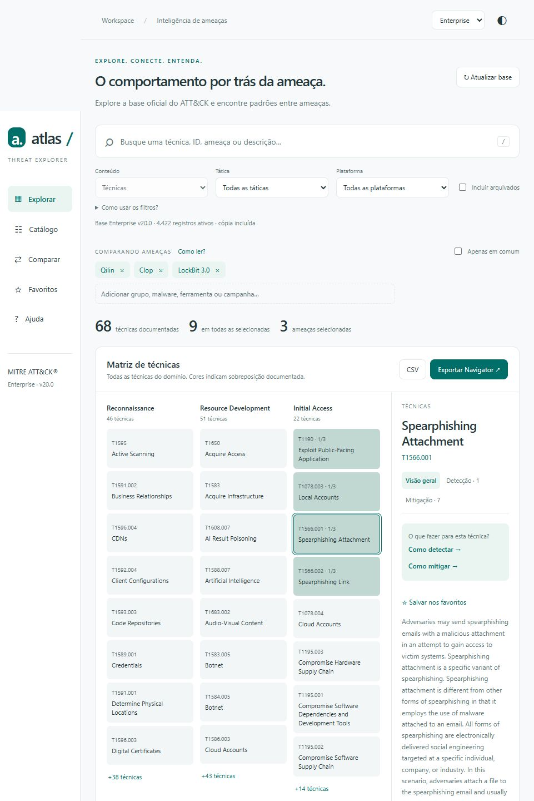

# Atlas — ATT&CK Explorer

Página estática independente, sem banco de dados ou servidor de aplicação. A interface está em português; os nomes, descrições e evidências preservam o texto oficial.

## Visão da plataforma



[Ver a captura da página completa](docs/images/atlas-home.jpg)

## Funcionalidades

- Consulta dos domínios Enterprise, Mobile e ICS.
- Busca por nome, ID, aliases e descrição, com filtros por tática e plataforma.
- Detecção com estratégias, analíticas por plataforma e fontes de log.
- Mitigações com aplicação específica à técnica.
- Comparação de ameaças, exportação CSV e camadas para o ATT&CK Navigator.
- Guia em português em `dist/help.html` e ajuda contextual.
- Favoritos, preferências locais e tema claro/escuro.

## Abrir localmente

O passo a passo abaixo é para **Windows 10/11**, usando PowerShell ou Terminal do Windows. Não é necessário ter experiência em programação.

### 1. Confira os requisitos

| Requisito | Precisa instalar? | Link oficial | Para que serve |
| --- | --- | --- | --- |
| **Python 3** | Sim, se ainda não estiver instalado, para o método deste guia | [Baixar Python para Windows](https://www.python.org/downloads/windows/) | Executar o servidor local que entrega os arquivos ao navegador |
| **Navegador atualizado** | Use um que já tenha instalado | [Microsoft Edge](https://www.microsoft.com/edge/download) · [Firefox](https://www.mozilla.org/firefox/new/) | Abrir e usar a plataforma |
| **Git** | Opcional: necessário somente se escolher clonar o repositório | [Baixar Git para Windows](https://git-scm.com/install/windows) | Baixar o código e receber alterações com `git pull` |
| **Node.js LTS** | Opcional: somente para verificações e preparação dos dados incluídos | [Baixar Node.js](https://nodejs.org/en/download) | Executar `verify.mjs` e `build-data.mjs` |

**Para apenas usar a plataforma, basta Python e um navegador.** Você pode baixar o projeto em ZIP e dispensar o Git. Node.js, npm, pip, banco de dados e bibliotecas adicionais não são necessários para iniciar a página.

### 2. Instale e confira o Python

1. Acesse a [página oficial de downloads do Python para Windows](https://www.python.org/downloads/windows/).
2. Baixe o **Python install manager**, abra o arquivo e conclua a instalação. Se aparecer uma configuração inicial, siga as orientações para disponibilizar os comandos no terminal.
3. Feche e reabra o PowerShell. Para instalar a versão padrão oferecida pelo gerenciador, execute:

   ```powershell
   py install default
   ```

4. Confirme que o interpretador Python 3 está disponível:

   ```powershell
   py -3 --version
   ```

   O resultado deve começar com `Python 3.`. Se você já tem Python 3 e esse comando funciona, pode pular a instalação. `py install default` se aplica ao novo gerenciador; o launcher antigo não oferece esse subcomando.

Se você usou um instalador tradicional com a opção **Add python.exe to PATH**, habilite-a durante a instalação. Se somente `python --version` funcionar e mostrar Python 3, use `python` no lugar de `py -3` nos comandos abaixo.

Referência para instalação e solução de problemas: [Python no Windows — documentação oficial](https://docs.python.org/3/using/windows.html).

### 3. Baixe a plataforma

Escolha **uma** das opções:

**Opção A — ZIP, sem instalar Git**

1. No [repositório](https://github.com/felipenicacio/atlas-attack-explorer), clique em **Code → Download ZIP**, ou use o [download direto do ZIP](https://github.com/felipenicacio/atlas-attack-explorer/archive/refs/heads/main.zip).
2. Clique com o botão direito no arquivo baixado e escolha **Extrair Tudo**. Não execute a página de dentro do ZIP.
3. Abra a pasta extraída que contém `README.md` e, dentro dela, a pasta **dist**.
4. Na barra de endereços do Explorador de Arquivos, digite `powershell` e pressione Enter. O terminal abrirá nessa pasta.

**Opção B — Git**

1. Instale o [Git para Windows](https://git-scm.com/install/windows) e mantenha habilitado seu uso no terminal. Feche e reabra o PowerShell.
2. Confira a instalação:

   ```powershell
   git --version
   ```

3. Abra um terminal na pasta em que quer guardar o projeto e execute, uma linha por vez:

   ```powershell
   git clone https://github.com/felipenicacio/atlas-attack-explorer.git
   cd atlas-attack-explorer
   cd dist
   ```

Nas duas opções, o terminal deve estar em **dist**, a pasta que contém `index.html`, `app.mjs`, `help.html` e a subpasta `data`.

### 4. Inicie e abra a plataforma

No terminal aberto em `dist`, execute:

```powershell
py -3 -m http.server 8765 --bind 127.0.0.1
```

Quando aparecer `Serving HTTP on 127.0.0.1 port 8765`, abra **[http://127.0.0.1:8765](http://127.0.0.1:8765)** no navegador.

- **Mantenha o terminal aberto** enquanto usa a plataforma.
- Para encerrar, pressione **Ctrl+C** nesse terminal.
- Para usar novamente, abra o terminal em `dist` e repita o comando do servidor.
- O guia de utilização fica no menu **Ajuda** ou em [http://127.0.0.1:8765/help.html](http://127.0.0.1:8765/help.html).
- O endereço `127.0.0.1` atende somente este computador. Você não precisa abrir portas no roteador nem publicar o site para uso local.

É necessário servir os arquivos por HTTP: **não abra `index.html` por duplo clique**, pois os módulos e o carregamento dos dados dependem do servidor. A consulta à cópia incluída funciona sem conexão com o MITRE; o botão **Atualizar base** precisa de internet.

**macOS e Linux:** com Python 3 instalado, abra o terminal em `dist` e use `python3 -m http.server 8765 --bind 127.0.0.1`. Os demais passos de acesso são iguais. Consulte os [downloads oficiais do Python](https://www.python.org/downloads/) para o seu sistema.

### 5. Problemas comuns

| O que aconteceu | Como resolver |
| --- | --- |
| `py` ou `python` não é reconhecido | Reabra o terminal e confira a instalação. Se `python --version` mostrar Python 3, use `python -m http.server 8765 --bind 127.0.0.1`. Se nenhum funcionar, consulte a documentação de instalação acima. |
| Apareceu `No module named install` | Você está usando o launcher antigo com `py install default`. Se `py -3 --version` já funcionar, siga direto para a execução. Caso contrário, instale o gerenciador atual pelo link oficial. |
| O navegador mostra uma lista de arquivos em vez da plataforma | O servidor foi iniciado fora de `dist`. Encerre com Ctrl+C, entre em `dist` e execute novamente. |
| `Address already in use`, porta ocupada ou erro de acesso à porta | Tente `py -3 -m http.server 8766 --bind 127.0.0.1` e abra [http://127.0.0.1:8766](http://127.0.0.1:8766). |
| Não é possível acessar a página | Confirme que o terminal continua aberto, que o servidor iniciou e que a porta do endereço é a mesma do comando. Use `http://`, conforme o exemplo. |
| A página abre, mas os dados não carregam | Confirme que extraiu o ZIP inteiro, preservou `dist/data/` e abriu o endereço HTTP do servidor. Consulte também a mensagem de erro exibida na plataforma. |
| O botão Atualizar base falha | Confira o acesso à internet e a `raw.githubusercontent.com`. A consulta à cópia já carregada continua disponível. |

### 6. Receba novas versões do código

Se usou Git, encerre o servidor, abra o terminal na **raiz do repositório** (a pasta que contém `README.md`) e execute:

```powershell
git pull --ff-only
cd dist
py -3 -m http.server 8765 --bind 127.0.0.1
```

Se houver alterações locais que impeçam a atualização, preserve-as antes de resolver o conflito. Se usou ZIP, baixe a nova versão e extraia em outra pasta. Depois de iniciar a nova versão, recarregue o navegador com **Ctrl+F5**.

**Atualizar base** renova os dados do MITRE no navegador; não atualiza o código da plataforma.

## Dados

Inclui os três domínios completos STIX 2.1, normalizados para consulta, na versão 20.0: Enterprise, Mobile e ICS. Os registros de conteúdo revogados ou descontinuados são preservados e podem ser exibidos por filtro. Identidades, marcações e metadados de coleção não aparecem como conteúdo pesquisável. Relacionamentos ativos ficam disponíveis nos detalhes.

O botão Atualizar baixa o STIX do domínio atual diretamente do repositório oficial `mitre-attack/attack-stix-data` no GitHub, normaliza em memória e mantém um cache no IndexedDB. A versão incluída continua disponível se a atualização falhar. Não usa TAXII nem proxy. Requer acesso a raw.githubusercontent.com para atualização; a consulta inicial usa os dados incluídos com a página.

Preferências, favoritos, seleção de ameaças e aparência são guardados no localStorage. Nenhum dado de usuário é enviado a um banco de dados. GitHub e hospedagem recebem as solicitações HTTP normais. Não há serviços de rastreamento.

## Comparação

Score = quantidade distinta de entidades selecionadas que possuem uma relação direta ativa `uses` com a técnica. Não há inferência transitiva grupo → ferramenta → técnica, propagação aos pais ou ponderação por incidentes. A matriz pode repetir técnicas em várias táticas. Não implica frequência real de uso. Arquivados ficam fora da pontuação e da exportação Navigator.

CSV exporta os resultados dos filtros atuais. Navigator exporta todas as relações diretas válidas das ameaças selecionadas, independentemente dos filtros visuais.

## Atualizar os dados incluídos

Baixe os três bundles oficiais para `raw/{domain}.json` e execute `node build-data.mjs`. Essa pasta não é publicada. A interface funciona sem dependências externas, bibliotecas ou etapa de compilação.

MITRE ATT&CK® é marca registrada de The MITRE Corporation. Este projeto não é oficial. A licença dos dados está em `dist/data/LICENSE-MITRE.txt`.

## Verificação

Esta etapa é opcional para quem deseja verificar o projeto. Instale a versão **LTS** do [Node.js pelo site oficial](https://nodejs.org/en/download), reabra o terminal e confira com `node --version`. Depois, execute na raiz do repositório:

```sh
node --check dist/app.mjs
node --check dist/help.js
node verify.mjs
```

Os testes conferem os relacionamentos, a pontuação, a exportação e exemplos de detecção e mitigação contra os dados incluídos.

## Hospedagem

Publique o conteúdo de `dist/` em uma hospedagem de arquivos estáticos. Não é necessário instalar dependências, compilar o código ou configurar um banco de dados. Preserve a pasta `data/` e seus arquivos de relacionamentos.

Esta é uma cópia independente do código da plataforma. Alterações neste repositório não são publicadas automaticamente no Site original. Favoritos e preferências são específicos de cada navegador e endereço. As configurações privadas da hospedagem original não fazem parte desta cópia.
